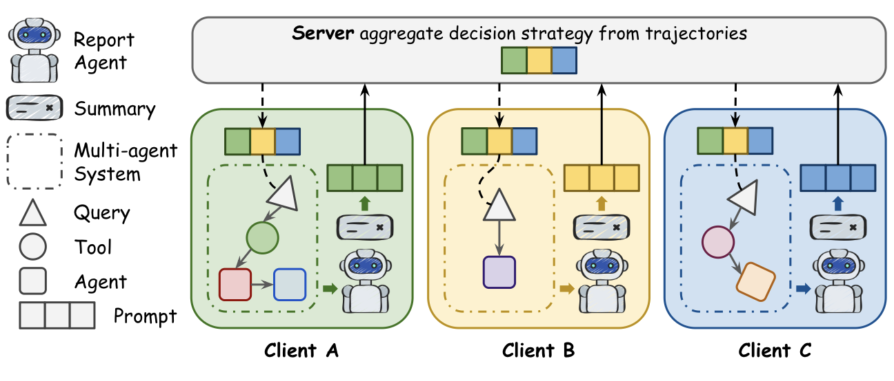

# FedPAO

FedPAO is a framework for experiments on **Federated Black-box Prompt Learning for Agentic Orchestrators**.

<p align="center">
  
</p>

Its purpose is to help heterogeneous multi-agent systems orchestrate better by learning from the orchestration behavior observed across different MAS configurations. Each client may use a different orchestrator, dataset, routing policy, or agent composition. FedPAO collects the resulting orchestration traces, summarizes what worked or failed, converts those observations into client-level soft prompt latents, and federates them into a shared global prompt. Later rounds reuse that global prompt so each MAS can make better orchestration decisions without directly fine-tuning the underlying LLM.

## What This Framework Does

- Trains or initializes client-specific MAS baseline checkpoints.
- Runs validation split inference examples for round-level accuracy.
- Runs a small held-out trajectory set for summary generation and prompt updates.
- Uses a summary agent to analyze the resulting trajectories.
- Converts analysis summaries into soft prompt latents.
- Refines client prompts with CMA-ES.
- Aggregates client prompts with FedAvg into a server global prompt.
- Injects the global prompt as an embedding-level prefix in later local LLM calls.

The default configuration is `configs/fedpao_six_clients.yaml`. It connects MASRouter and GPT-Swarm clients to MMLU-Pro and GSM-Hard datasets.

By default, each client samples 100 examples, uses an 80/20 train-validation split for round-level validation, and reserves 3 additional held-out examples for summary trajectory analysis.

## Project Layout

```text
configs/             FedPAO experiment configs
docs/                Environment notes and round-flow documentation
scripts/run.py       Round 0 training and federated round runner
scripts/run_client_inference.py
                     Standalone MAS baseline inference smoke test
src/orchestrators/   MASRouter and GPT-Swarm wrappers/native adapters
third_party/         External MAS repositories, git ignored
outputs/runs/        Run outputs, manifests, checkpoints, and artifacts
```

## Environment Setup

### 1. Create a Python virtual environment

```bash
python3 -m venv .venv
source .venv/bin/activate
python3 -m pip install --upgrade pip setuptools wheel
```

### 2. Install PyTorch

Install PyTorch first, using the wheel that matches your CUDA version. For example, for the CUDA 12.6 wheel:

```bash
pip install torch torchvision torchaudio --index-url https://download.pytorch.org/whl/cu126
```

If your machine uses a different CUDA/PyTorch combination, choose the appropriate command from the [PyTorch installation guide](https://pytorch.org/get-started/locally/).

### 3. Install FedPAO dependencies

```bash
pip install -r requirements.txt
```

### 4. Clone external MAS repositories

FedPAO expects external MAS implementations to live under `third_party/`. This directory is intentionally excluded from git.

```bash
mkdir -p third_party

git clone --depth 1 \
  https://github.com/yanweiyue/masrouter.git \
  third_party/masrouter

git clone --depth 1 \
  https://github.com/metauto-ai/GPTSwarm.git \
  third_party/GPTSwarm
```

### 5. Configure the local model path

The default local model path is defined in `configs/fedpao_six_clients.yaml` under `model.model_id`.

```yaml
model:
  backend: hf_local
  model_id: /data/digirl/checkpoints/Qwen3-4B-Instruct/
```

To use a different local Hugging Face checkpoint, either edit the config or pass `--model-path` at runtime.

```bash
.venv/bin/python scripts/run.py \
  --model-path /path/to/local/hf/checkpoint \
  --start-round 0 \
  --rounds 4
```

## Running FedPAO

### Run the full round loop

Start from round 0, then run federated rounds 1 through 4:

```bash
CUDA_VISIBLE_DEVICES=1 .venv/bin/python scripts/run.py \
  --start-round 0 \
  --rounds 4
```

By default, outputs are written under `outputs/runs/<run-name>/`. Each round stores its own manifest, client checkpoints, trajectories, analysis reports, and prompt artifacts.

```text
outputs/runs/<run-name>/
  config.yaml
  manifest.json
  round_000/
    manifest.json
  round_001/
    inference.jsonl
    analysis_manifest.json
    manifest.json
    server/
      global_prompt_manifest.json
      global_prompt_round002.pt
```

### Run a quick smoke test

To check the round flow and artifact contract without running the external MAS native trainers, use `--round0-trainer artifact`.

```bash
CUDA_VISIBLE_DEVICES=1 .venv/bin/python scripts/run.py \
  --round0-trainer artifact \
  --max-samples-per-client 1 \
  --start-round 0 \
  --rounds 1
```

### Run only one MAS baseline

```bash
CUDA_VISIBLE_DEVICES=1 .venv/bin/python scripts/run.py \
  --mas masrouter \
  --start-round 0 \
  --rounds 2
```

Currently supported values are `masrouter` and `gptswarm`.

### Resume an existing run

To resume from round 1 after an existing run has already produced `round_000`:

```bash
CUDA_VISIBLE_DEVICES=1 .venv/bin/python scripts/run.py \
  --run-root outputs/runs/<run-name> \
  --start-round 1 \
  --rounds 4
```

With `--start-round N`, the runner loads the manifest from `round_(N-1)` and continues from there.

### Run standalone baseline inference

Use `scripts/run_client_inference.py` when you only want to test an individual MAS wrapper instead of the full round runner.

```bash
CUDA_VISIBLE_DEVICES=1 .venv/bin/python scripts/run_client_inference.py --mas masrouter
CUDA_VISIBLE_DEVICES=1 .venv/bin/python scripts/run_client_inference.py --mas gptswarm
```

## Important Options

```text
--config                         YAML config to load
--run-name                       Name for a new run
--run-root                       Existing or new run directory
--output-dir                     Run output root, default outputs/runs
--model-path                     Local Hugging Face checkpoint path
--third-party-dir                External MAS repository root, default third_party
--mas                            MAS names to run
--start-round                    First round to execute, default 0
--rounds                         Last post-training round to execute
--orchestrator-mode              native or simulated
--round0-trainer                 native or artifact
--max-train-samples-per-client   Round 0 train sample limit
--max-valid-samples-per-client   Round validation sample limit
--max-samples-per-client         Override held-out summary trajectory sample limit
--dtype                          auto, float16, bfloat16, float32
```

See the full CLI help with:

```bash
.venv/bin/python scripts/run.py --help
```

## Additional Documentation

- `docs/environment_setup.md`: Environment and dependency setup notes
- `docs/orchestrator_setup.md`: MASRouter and GPT-Swarm adapter notes
- `docs/run_round_training_flow.md`: Round-by-round execution flow for `scripts/run.py`
